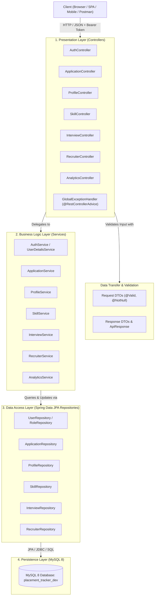

# System Architecture: Internship and Placement Application Tracker

## 1. Executive Overview
The **Internship and Placement Application Tracker** is a robust, enterprise-ready web service engineered using **Spring Boot 3.4.x**, **Java 21 LTS**, and **MySQL 8.x**. The platform centralizes, tracks, and analyzes student applications for internships and full-time campus placements, facilitating collaboration among students, recruiters, and placement officers.

---

## 2. Technology Stack
- **Runtime Environment**: Java 21 LTS (OpenJDK)
- **Framework**: Spring Boot 3.4.x
  - Spring Web (RESTful APIs)
  - Spring Data JPA (Object-Relational Mapping with Hibernate)
  - Spring Validation (Jakarta Validation / Hibernate Validator)
  - Spring Security (Stateless JWT Authentication & RBAC)
- **Database**: MySQL 8.x
- **Build Tool**: Apache Maven (via Maven Wrapper `mvnw` / `mvnw.cmd`)
- **Boilerplate Reduction**: Project Lombok
- **Testing**: JUnit 5, AssertJ, Spring Boot Test, Spring Security Test

---

## 3. Layered Architectural Model
The application adheres strictly to standard enterprise layered architecture principles to ensure high cohesion, low coupling, and testability.

---

## 4. Team Ownership & Module Responsibilities

The codebase divides domain responsibilities among three development streams and a shared infrastructure layer:

| Stream | Module Package | Key Entities & Components | Primary Responsibilities |
| :--- | :--- | :--- | :--- |
| **Developer 1** | `com.placementtracker.auth` `com.placementtracker.application` | `User`, `Role`, `JobApplication`, `ApplicationStatusHistory` | Authentication, JWT issue/refresh, RBAC, application lifecycle state transitions (APPLIED, IN_REVIEW, SHORTLISTED, REJECTED, ACCEPTED). |
| **Developer 2** | `com.placementtracker.profile` `com.placementtracker.skills` | `StudentProfile`, `Education`, `Skill`, `StudentSkill` | Student resumes, CGPA, graduation years, skill taxonomy, and matching algorithms against job requirements. |
| **Developer 3** | `com.placementtracker.interview` `com.placementtracker.recruiter` `com.placementtracker.analytics` | `InterviewRound`, `Recruiter`, `Company`, `PlacementAnalytics` | Interview schedules, feedback and scores, company directories, recruiter contacts, placement KPIs and reports. |
| **Shared** | `com.placementtracker.common` `com.placementtracker.config` `com.placementtracker.enums` | `ApiResponse<T>`, `PageResponse<T>`, `BaseAuditEntity`, `GlobalExceptionHandler`, `SecurityConfig` | Consistent API contracts, pagination standards, JPA auditing (`created_at`, `updated_at`), error translation, global bean configs. |

---

## 5. Cross-Cutting Design Principles

1. **Information Hiding**: Entities are never exposed through REST controllers. Every API endpoint consumes request DTOs and returns response DTOs wrapped in `ApiResponse<T>`.
2. **Defensive Validation**: Incoming payloads use declarative Jakarta Bean Validation (`@NotNull`, `@Size`, `@Email`, etc.) with fail-fast global handling.
3. **Stateless Security**: Authentication issues cryptographically signed JWT tokens with expiration; all secure endpoints authenticate via `OncePerRequestFilter`.
4. **Auditing**: All persistent domain models inherit from `BaseAuditEntity` to automatically populate audit trails (`created_at`, `updated_at`).
