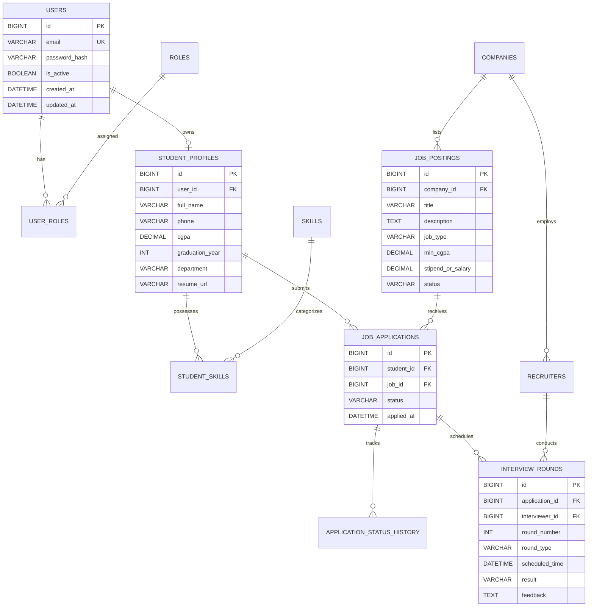

# Database Design: Internship and Placement Application Tracker

## 1. Overview and Standards
The database schema for the Internship and Placement Application Tracker is deployed on **MySQL 8.x** using `InnoDB` with `utf8mb4` encoding (`utf8mb4_unicode_ci`).

### Universal Database Standards:
1. **Naming Conventions**: Table names and column names use snake_case (`created_at`, `job_application_id`).
2. **Primary Keys**: Every table uses a surrogate primary key `id BIGINT AUTO_INCREMENT PRIMARY KEY`.
3. **Audit Columns**: Every persistent business entity inherits `created_at DATETIME(6) NOT NULL` and `updated_at DATETIME(6) NOT NULL`.
4. **Foreign Key Indexing**: All foreign key reference columns have explicit indexes to eliminate table scans during joins and cascades.

---

## 2. Conceptual Entity-Relationship Diagram



---

## 3. Detailed Table Specifications

### 3.1 `users` & `roles`
```sql
CREATE TABLE roles (
    id BIGINT AUTO_INCREMENT PRIMARY KEY,
    name VARCHAR(50) NOT NULL UNIQUE,
    created_at DATETIME(6) NOT NULL,
    updated_at DATETIME(6) NOT NULL
) ENGINE=InnoDB;

CREATE TABLE users (
    id BIGINT AUTO_INCREMENT PRIMARY KEY,
    email VARCHAR(150) NOT NULL UNIQUE,
    password_hash VARCHAR(255) NOT NULL,
    first_name VARCHAR(100) NOT NULL,
    last_name VARCHAR(100) NOT NULL,
    is_active BOOLEAN NOT NULL DEFAULT TRUE,
    created_at DATETIME(6) NOT NULL,
    updated_at DATETIME(6) NOT NULL,
    INDEX idx_users_email (email)
) ENGINE=InnoDB;

CREATE TABLE user_roles (
    user_id BIGINT NOT NULL,
    role_id BIGINT NOT NULL,
    PRIMARY KEY (user_id, role_id),
    CONSTRAINT fk_ur_user FOREIGN KEY (user_id) REFERENCES users (id) ON DELETE CASCADE,
    CONSTRAINT fk_ur_role FOREIGN KEY (role_id) REFERENCES roles (id) ON DELETE CASCADE
) ENGINE=InnoDB;
```

### 3.2 `student_profiles` & `skills`
```sql
CREATE TABLE student_profiles (
    id BIGINT AUTO_INCREMENT PRIMARY KEY,
    user_id BIGINT NOT NULL UNIQUE,
    student_id_number VARCHAR(50) NOT NULL UNIQUE,
    phone VARCHAR(20),
    department VARCHAR(100) NOT NULL,
    graduation_year INT NOT NULL,
    cgpa DECIMAL(3,2) NOT NULL,
    resume_url VARCHAR(500),
    created_at DATETIME(6) NOT NULL,
    updated_at DATETIME(6) NOT NULL,
    CONSTRAINT fk_sp_user FOREIGN KEY (user_id) REFERENCES users (id) ON DELETE CASCADE,
    INDEX idx_sp_cgpa (cgpa),
    INDEX idx_sp_grad_year (graduation_year)
) ENGINE=InnoDB;

CREATE TABLE skills (
    id BIGINT AUTO_INCREMENT PRIMARY KEY,
    name VARCHAR(100) NOT NULL UNIQUE,
    category VARCHAR(50) NOT NULL,
    created_at DATETIME(6) NOT NULL,
    updated_at DATETIME(6) NOT NULL,
    INDEX idx_skill_name (name)
) ENGINE=InnoDB;

CREATE TABLE student_skills (
    id BIGINT AUTO_INCREMENT PRIMARY KEY,
    student_profile_id BIGINT NOT NULL,
    skill_id BIGINT NOT NULL,
    proficiency_level VARCHAR(30) NOT NULL,
    created_at DATETIME(6) NOT NULL,
    updated_at DATETIME(6) NOT NULL,
    CONSTRAINT fk_ss_profile FOREIGN KEY (student_profile_id) REFERENCES student_profiles (id) ON DELETE CASCADE,
    CONSTRAINT fk_ss_skill FOREIGN KEY (skill_id) REFERENCES skills (id) ON DELETE CASCADE,
    UNIQUE KEY uk_student_skill (student_profile_id, skill_id)
) ENGINE=InnoDB;
```

### 3.3 `companies`, `recruiters`, & `job_postings`
```sql
CREATE TABLE companies (
    id BIGINT AUTO_INCREMENT PRIMARY KEY,
    name VARCHAR(150) NOT NULL UNIQUE,
    website VARCHAR(255),
    industry VARCHAR(100),
    created_at DATETIME(6) NOT NULL,
    updated_at DATETIME(6) NOT NULL
) ENGINE=InnoDB;

CREATE TABLE recruiters (
    id BIGINT AUTO_INCREMENT PRIMARY KEY,
    user_id BIGINT NOT NULL UNIQUE,
    company_id BIGINT NOT NULL,
    designation VARCHAR(100),
    phone VARCHAR(20),
    created_at DATETIME(6) NOT NULL,
    updated_at DATETIME(6) NOT NULL,
    CONSTRAINT fk_rec_user FOREIGN KEY (user_id) REFERENCES users (id) ON DELETE CASCADE,
    CONSTRAINT fk_rec_company FOREIGN KEY (company_id) REFERENCES companies (id) ON DELETE RESTRICT
) ENGINE=InnoDB;

CREATE TABLE job_postings (
    id BIGINT AUTO_INCREMENT PRIMARY KEY,
    company_id BIGINT NOT NULL,
    title VARCHAR(150) NOT NULL,
    description TEXT NOT NULL,
    job_type VARCHAR(30) NOT NULL, -- INTERNSHIP, FULL_TIME
    location VARCHAR(100),
    min_cgpa DECIMAL(3,2) DEFAULT 0.00,
    stipend_or_salary DECIMAL(12,2),
    deadline DATETIME NOT NULL,
    status VARCHAR(30) NOT NULL DEFAULT 'OPEN',
    created_at DATETIME(6) NOT NULL,
    updated_at DATETIME(6) NOT NULL,
    CONSTRAINT fk_jp_company FOREIGN KEY (company_id) REFERENCES companies (id) ON DELETE CASCADE,
    INDEX idx_jp_status_deadline (status, deadline)
) ENGINE=InnoDB;
```

### 3.4 `job_applications` & `interview_rounds`
```sql
CREATE TABLE job_applications (
    id BIGINT AUTO_INCREMENT PRIMARY KEY,
    student_profile_id BIGINT NOT NULL,
    job_posting_id BIGINT NOT NULL,
    status VARCHAR(40) NOT NULL DEFAULT 'APPLIED',
    cover_letter TEXT,
    applied_at DATETIME(6) NOT NULL,
    created_at DATETIME(6) NOT NULL,
    updated_at DATETIME(6) NOT NULL,
    CONSTRAINT fk_ja_student FOREIGN KEY (student_profile_id) REFERENCES student_profiles (id) ON DELETE CASCADE,
    CONSTRAINT fk_ja_job FOREIGN KEY (job_posting_id) REFERENCES job_postings (id) ON DELETE CASCADE,
    UNIQUE KEY uk_app_student_job (student_profile_id, job_posting_id),
    INDEX idx_ja_status (status)
) ENGINE=InnoDB;

CREATE TABLE interview_rounds (
    id BIGINT AUTO_INCREMENT PRIMARY KEY,
    application_id BIGINT NOT NULL,
    interviewer_id BIGINT,
    round_number INT NOT NULL,
    round_type VARCHAR(50) NOT NULL, -- ONLINE_ASSESSMENT, TECHNICAL, HR
    scheduled_time DATETIME NOT NULL,
    meeting_link VARCHAR(255),
    status VARCHAR(30) NOT NULL DEFAULT 'SCHEDULED',
    feedback TEXT,
    score INT,
    created_at DATETIME(6) NOT NULL,
    updated_at DATETIME(6) NOT NULL,
    CONSTRAINT fk_ir_application FOREIGN KEY (application_id) REFERENCES job_applications (id) ON DELETE CASCADE,
    CONSTRAINT fk_ir_interviewer FOREIGN KEY (interviewer_id) REFERENCES users (id) ON DELETE SET NULL,
    INDEX idx_ir_scheduled (scheduled_time)
) ENGINE=InnoDB;
```
